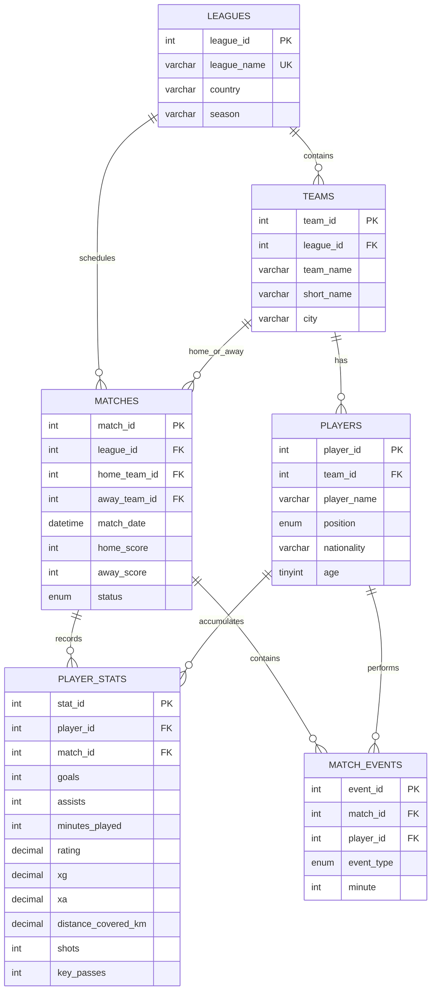

# FootballIQ ER Diagram

## Relationship notes
- One league contains many teams and many matches.
- Each player belongs to one team; a team can have many players.
- Each match has one home team and one away team, both referenced from `teams`.
- `player_stats` is an associative/statistics table between players and matches. A unique `(player_id, match_id)` constraint prevents duplicate stat rows for the same player and match.
- `match_events` stores detailed match incidents such as goals and cards.

## Normalization
The schema is designed to be approximately in Third Normal Form for the project scope: team, league, player, match and event facts are stored in their own tables; names are not repeated as the source of truth in the stats table. Foreign keys enforce referential integrity. `player_stats` stores per-player/per-match statistics and uses a unique composite business key.

## Reporting objects
- `v_player_comparison` aggregates each player's appearances, goals, assists, average rating, xG, xA, total distance and per-90 expected contribution.
- `GetLeagueResults(league_id)` stored procedure returns played match results for a league.
- `before_player_stats_insert` trigger validates ratings and rejects negative xG, xA or distance values.
